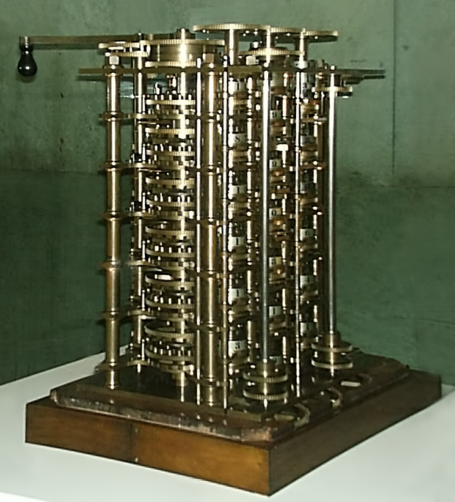
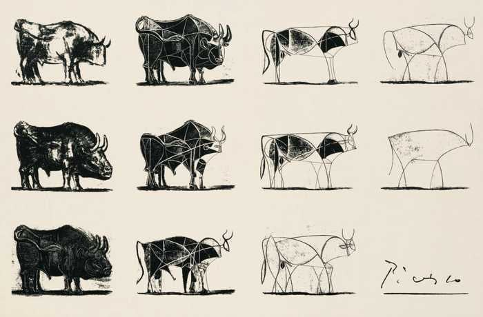

> [!ABSTRACT]
> Destack is a softare engine for building and deploying application software - like Unreal, but for general purpose software.
> Think Github + NPM + Convex + Vercel + Sentry in a box, with all the boring integration already done: auth, schemas, migrations, multiplayer, permissions, workflows, telemetry, and infra.
>
> Integrate your agents into programmable first-party apps, and then remix your own custom apps on one trusted foundation.
> Destack is built around one hackable "platform core" with open formats and standards, so integration and migration are just one prompt.
>
> [Skip to The Destack](#the-destack)

Software is entering its Cambrian Explosion, and - it is worth remembering - that means most species will go extinct, and the survivors will look rather different.
Both products and processes will undergo intense evolutionary pressure, with fast migrations enabling the full exploration of the space of all possible software until a new optimum emerges.

{width=600}
[Cambrian marine life](https://www.eurekalert.org/multimedia/686747) — Huang Diying, Chinese Academy of Sciences.

The contemporary stack is structurally broken.
The "stack" is a thousand little silos, each with their own slightly incompatible slice of software, each demanding its own terms and standards and formats.
It was never designed as one whole; it evolved as a mosaic of different technologies and services where nothing _quite_ fits together. 

Now, the technical debt accumulated over decades of organic software growth is coming due.
Probabilistic computing is finally here, and we _could_ infuse intelligence into all software, but we're stuck on an opaque stack that rejects integration and modification at every layer.
Instead, we got "APIs" and now "MCPs".

> To put it quite bluntly: as long as there were no machines, programming was no problem at all; when we had a few weak computers, programming became a mild problem, and now we have gigantic computers, programming has become an equally gigantic problem.
>
> — Edsger Dijkstra, *The Humble Programmer* (1972)

The familiar features that make modern software "modern" - SaaS, multiplayer, multi-vendor, multi-cloud, heterogeneity - also make it hostile to agents.
Fragmenting context and siloing control as thoroughly as the old stack does is exactly the opposite of what personalised, malleable, intelligence-infused software needs. 

Half a century after the last software crisis, the computing stack is once again buckling under the weight, volume and speed of a more powerful machine.
Once again, we get to retrace from the beginning, reconsider what programming even means, and reshape what 21st-century software should look like.

# Higher Order Programming

The history of programming is one of monotonically increasing levels of abstraction in specifying mechanically repeatable behaviour: from handcrafting mechanical gears, to wiring up vacuum tubes, to punching paper cards, to coding assembly, to writing C, to programming Java, to scripting Python, to asking an LLM.

Climbing the ladder of abstraction yields more output for every (human) bit of input.
We gradually remove ourselves from the cumbersome burden of having to spell out _exactly_ what we want the machine to be doing: which gears? which wires? which bits? which registers? what memory? what computer? _where_ computer? _when_ computer?

{width=440}
[Difference Engine No. 1, 1832](https://commons.wikimedia.org/wiki/File:Babbages_difference_engine_1832.jpg) — Sebastian Wallroth, public domain.

Programming, then, is just reified problem solving: iterating, thinking, working to understand the shape of a problem and specifying its solution in some mechanically repeatable form.
We used to solve software-shaped problems with artisanal next-character-prediction of symbolic code, but, really, programming doesn't have to be any formal language at all.

Indeed, there was programming before code, there is programming after code - and programming _alongside_ code already has rich prior art!
Game developers have iterated on multimodal software production over decades:
early game development was a schlep where only a tiny guild of brilliant nerds managed to produce presentable commercial games.

To build a game, _everyone_ had to write their own graphics, networking, scripting, asset pipelines, editors - a whole engine for every game, on top of the actual game!
Then, we figured out how to package the hard bits into reusable components, and those into complete, higher-level packages we call "game engines".

{width=480}
[150 Extra Engineers, 1951](https://commons.wikimedia.org/wiki/File:IBM_150_Extra_Engineers_1951.jpg) — IBM.

Crucially, modern game engines go _far_ beyond traditional "software frameworks" like Django or Rails or some blend of cloud services. 
The best game engines are integrated software platforms: a runtime, an editor, tools, VCS integrations, netcode, a deployment platform, and myriad affordances for prototyping, iterating, refining, and shipping games.

Like most new abstractions, game engines _initially_ didn't provide quite the same level of control as their underlying substrate.
Over time, however, building with a game engine became so much more productive that it enabled a new scale of project, and empowered a new type of contributor - designers, writers, and artists could now contribute _directly_.

Game engines never "superseded" code, even as a lot of code was abstracted away for use cases that previously required it.
Code is still there, it's still relevant, but - thanks to game engines - you can build and ship commercial games without thinking in code.

# The Software Engine

General purpose software is now hitting the same issues that games have long solved.
The principal components of modern software have ossified, but they're scattered and reconstituted a thousand different ways.
General software needs its own "software engine": _integrated_ "platform software" with building blocks for a new level of "userland software". 

It is insufficient to accelerate the software production _process_, not just because of Amdahl's law, but because to miss _any_ part of the software is to lose the shape of the whole product - and software that doesn't solve any reality-shaped problem is pointless.
Steering only through the peephole of a chatbox, you lose track of where to go next, and how to get there, in frighteningly short order.

Oddly, the primary objective of "software factories" seems to be _removing_ oneself from all production processes without any new higher order specification to anchor this higher level of programming.
In other words, the software _factory_ requires a software _engine_, because the precise industrial-scale manufacture of quality software must be built on _new_ integrated processes that span the entire lifecycle.

{width=640}
[Wright Flyer replica in the Ames wind tunnel](https://www.nasa.gov/image-article/wright-flyer/) — NASA, public domain.

Despite half a century of development, our tools for building and understanding software systems are surprisingly primitive.
We _still_ struggle with "works on my machine", and reproducing observed issues in the "laboratory" is virtually impossible.
If software is going to run _everything_, faster than anyone can verify, how do we make sure it's the right software?

Fundamentally, there is not a single test, certificate, proof, or magic gate that you can run to convince me that some non-trivial general software program is correct.
The correctness of any complex software system spans many granularities, and mathematical "proof", green tests, smoke tests, and passing gates all mean nothing if it's not what I actually _meant_.

The only way to ensure correctness for general purpose software - that is: does it do what it should? - is to look, to see the software in motion, from many different angles and granularities.
Notably, this is not an intelligence problem at all - it's a human problem, and a real world integration problem.
I just don't know what I want until I see it.

{width=600 poster=./tiny-glade.webp}
[Building in Tiny Glade](https://store.steampowered.com/app/2198150/Tiny_Glade/) — Pounce Light, release date trailer excerpt.

The continuous and iterative process of _shaping_ is critical not just for "malleable" software but - because programming is just reified problem solving - for all software.
Software development - from databases to web apps to spreadsheets - spans one continuous spectrum of reified problem solving that has been separated into rigid planes only by historical happenstance.

Until now, the cardinal sin of "malleable software" has been that "userland software" like spreadsheets is too limited, while "general software" is annoying to build and maintain.
Now, the equation has flipped: building is cheap, and the lack of integration is expensive.
How do you join "reminders in Notion" with "leads in Salesforce" and "events in Outlook"?

There are amazing new probabilistic computing capabilities to embed deeply and widely into all software, and the lack of integration is why we just have MCPs with chatboxes in the sidebar. 
Forms don't even _prefill_, software is not adaptive, apps are not magic - where is all the automation?
If we truly have higher order programming, where is the higher order software?

# The Destack

Higher order programming requires higher order processes with higher order specifications,
the necessary control for which can only be achieved by integrating and standardising the full stack.
Thus, we need a complete _software engine_ that provides both the fundamental building blocks for development and the platform services for deployment.

That is Destack: an open-source, hackable software engine and platform.
In product terms, think of Destack as an integrated system of software production with the principal building blocks for modern software _and_ a ready-to-wear suite of common applications built on top of them, ready to deploy, remix, and adopt. 

[The Bull, 1945–46](https://drawpaintacademy.com/the-bull/) — Pablo Picasso, reproduction via Draw Paint Academy.

The standardised Destack lets users actually _own_ their data and _rent_ the infrastructure as desired, 
This gets us integration and customisation for "free" while also reducing app switching to just a single click, and does not require everyone to "own their stack" _literally_, which would be too annoying, and give up all the nice benefits of modern cloud-based software.

In technical terms, think of Destack as a unified GitHub + npm + SQLite + Durable Objects with all the boring integration like auth, schemas, migrations, sync, triggers, workflows, telemetry, infra.
It's all standardised to enable a higher level of abstraction.

<!--> three kinds of personal software (replacement, custom, ephemeral)
> the p90 of apps (p80 shared, and then +p10 some custom stuff)-->

<!-- TODO: demo #1 -->

<!-- TODO: demo #2 -->

<!--Following the game engine model, Destack integrates libraries and tools for interactively building, understanding, and refining software products, all based on modern best practices.
It's as indestructible as can be, and you can host it entirely yourself, we can tunnel for you, or you could let us take care of everything.
(Or any combination.)-->

<!-- TODO: demo #2 -->

<!-- TODO: CTA? -->
