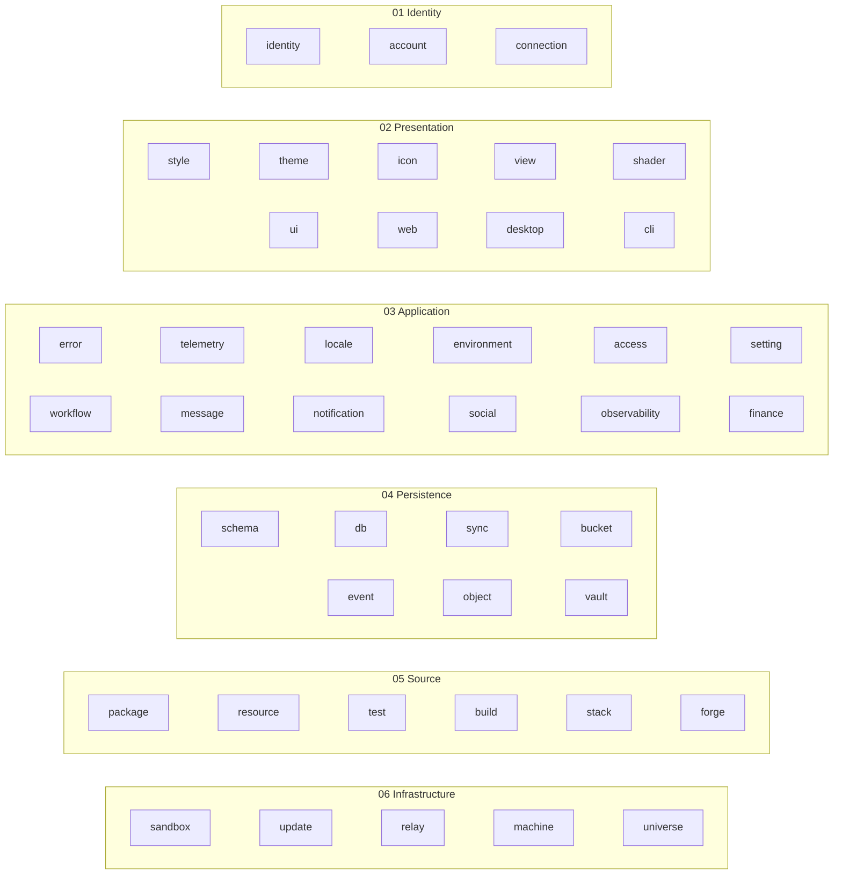

# Architecture

Destack is composed of six layers, from the people using it down to the machines running it.
Each layer is a set of packages under [`@destack`](@destack); the tables below list what each package does and the prior art it follows.

### 01 Identity

Who you are, and who gets in.

| Package | What it does | Prior art |
|---|---|---|
| [`@destack/identity`](@destack/identity) | Create self-certifying identities with signing and rotation keys, and keep keys in keyrings and keychains | did:plc, JWK, DPoP |
| [`@destack/account`](@destack/account) | Sign people in with magic links, passkeys, two-factor and OAuth, and serve accounts, spaces, domains and an OpenID Connect provider | Better Auth |
| [`@destack/connection`](@destack/connection) | Store credentials for external accounts and attach them to outbound requests | Nango |

### 02 Presentation

What you see and touch.

| Package | What it does | Prior art |
|---|---|---|
| [`@destack/style`](@destack/style) | Write component styles in StyleX, with Tailwind's breakpoints and preflight | StyleX, Tailwind |
| [`@destack/theme`](@destack/theme) | Define themes over colour roles, with contrast, nested surfaces, swatches and motion | Radix Themes, shadcn/ui |
| [`@destack/icon`](@destack/icon) | Draw icons by name, loaded lazily | Phosphor |
| [`@destack/view`](@destack/view) | Render package views in one shell, and give them live queries, mutations, settings and commands | Solid |
| [`@destack/shader`](@destack/shader) | Render animated gradients and effects as Solid components | Paper Shaders |
| [`@destack/ui`](@destack/ui) | Use buttons, dialogs, selects, sidebars, charts and the rest on Solid and StyleX | shadcn/ui, Radix, Base UI |
| [`@destack/web`](@destack/web) | Build websites with server rendering, prerendering, and sitemap, robots and manifest files | SolidStart, Next.js |
| [`@destack/desktop`](@destack/desktop) | Run the native shell: windows, menus, banners, the badge, the tray and the command palette | Tauri |
| [`@destack/cli`](@destack/cli) | Read and change a space's objects, stacks, installations and packages from the terminal | kubectl, gh |

### 03 Application

What your apps actually do.

| Package | What it does | Prior art |
|---|---|---|
| [`@destack/error`](@destack/error) | Declare the call errors callers receive, with their codes and HTTP statuses | gRPC status codes |
| [`@destack/telemetry`](@destack/telemetry) | Emit logs, traces and metrics, and capture errors and sessions, from any package | OpenTelemetry, Sentry |
| [`@destack/locale`](@destack/locale) | Write translatable messages and format them for a locale from catalogs | Lingui, MessageFormat 2 |
| [`@destack/environment`](@destack/environment) | Take time and the network as effects, real or simulated with virtual time and faults | FoundationDB simulation, TigerBeetle VOPR |
| [`@destack/access`](@destack/access) | Declare relations and permissions as a schema, and check, grant and request access | Zanzibar, SpiceDB |
| [`@destack/setting`](@destack/setting) | Declare typed settings and resolve each value along user, space, installation and device scopes | — |
| [`@destack/workflow`](@destack/workflow) | Run durable functions that record each step, with schedules, triggers and approvals | Temporal, DBOS, Inngest, Restate |
| [`@destack/message`](@destack/message) | Send email over SMTP, web push, webhooks and desktop messages, and sign webhook deliveries | Standard Webhooks |
| [`@destack/notification`](@destack/notification) | Record notifications per recipient, keep each person's inbox, and send them as messages under focus and summary settings | Knock, Novu |
| [`@destack/social`](@destack/social) | Add comments, reactions, read receipts, favourites and presence to any object type | Liveblocks |
| [`@destack/observability`](@destack/observability) | Store a space's logs, spans and metrics, group failures into issues, fire alerts, and declare usage meters | Sentry, Grafana |
| [`@destack/finance`](@destack/finance) | Declare products, features and metered usage, bill through a payment provider, and derive entitlements | Autumn, Orb |

### 04 Persistence

What they remember.

| Package | What it does | Prior art |
|---|---|---|
| [`@destack/schema`](@destack/schema) | Declare schemas limited to what JSON Schema expresses, with Temporal time types, and convert them both ways | Zod, JSON Schema |
| [`@destack/db`](@destack/db) | Define and query SQL tables on SQLite and PostgreSQL, with migrations, full-text search, sealed columns and a change log | Drizzle |
| [`@destack/sync`](@destack/sync) | Replicate queried rows from the change log to other databases and to browsers, with optimistic local writes | PostgreSQL logical replication, Replicache |
| [`@destack/bucket`](@destack/bucket) | Store files through the R2 binding API, in local directories, in R2 or in any S3-compatible store | Cloudflare R2, S3 |
| [`@destack/event`](@destack/event) | Append events to a table, compact them into Parquet segments, and query, aggregate and delete them | ClickHouse |
| [`@destack/object`](@destack/object) | Declare object types and their packages: synced tables with access rules, methods served and called over oRPC, workloads, history and events | Convex, oRPC, OpenAPI |
| [`@destack/vault`](@destack/vault) | Store versioned secrets encrypted at rest, generate keys, and stage and promote versions | AWS Secrets Manager |

### 05 Source

Where it all comes from, and how it changes.

| Package | What it does | Prior art |
|---|---|---|
| [`@destack/package`](@destack/package) | Describe a package in `destack.json`: its sandbox permissions, examples and scenarios, manifests and module transform | Deno permissions, Storybook |
| [`@destack/resource`](@destack/resource) | Declare resource kinds with desired state, and plan, apply and upgrade them through providers | Kubernetes CRDs, Terraform |
| [`@destack/test`](@destack/test) | Run tests and play declared scenarios through a driver per interaction | Vitest, Playwright |
| [`@destack/build`](@destack/build) | Compile a package into one output per runtime, and store builds by content | Vite, Rolldown, OCI registries |
| [`@destack/stack`](@destack/stack) | Declare a space's resources and package installations, and apply them as revisions with a plan and an approval | Pulumi, CloudFormation |
| [`@destack/forge`](@destack/forge) | Host Git repositories and publish packages as npm releases | GitHub, npm |

### 06 Infrastructure

Where it all runs.

| Package | What it does | Prior art |
|---|---|---|
| [`@destack/sandbox`](@destack/sandbox) | Run processes with explicit filesystem and network permissions on macOS and Linux | Seatbelt, bubblewrap |
| [`@destack/update`](@destack/update) | Check, download, stage and activate signed releases, and publish them | TUF |
| [`@destack/relay`](@destack/relay) | Route requests for a space's or a machine's name through a tunnel to the machine serving it | Cloudflare Tunnel, ngrok |
| [`@destack/machine`](@destack/machine) | Run spaces on any host, on Bun or Cloudflare, with placement, builds, a request gateway and metering | — |
| [`@destack/universe`](@destack/universe) | Run the account, setting and directory packages over one database, on Bun or as a Cloudflare Worker | — |
