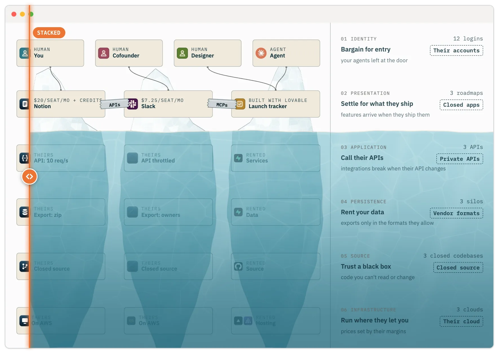
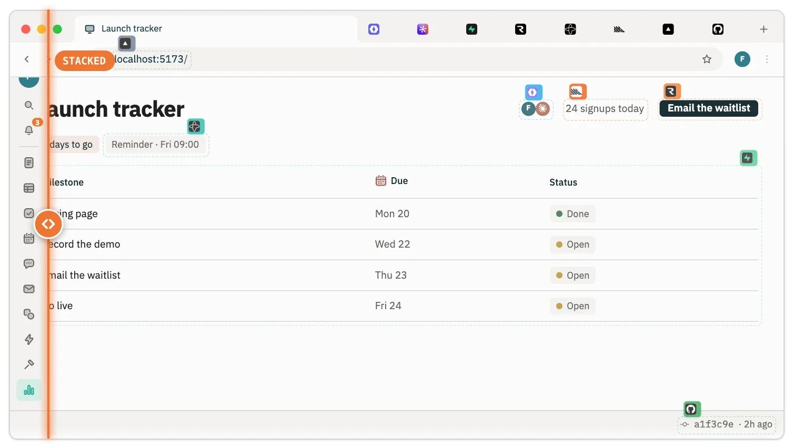
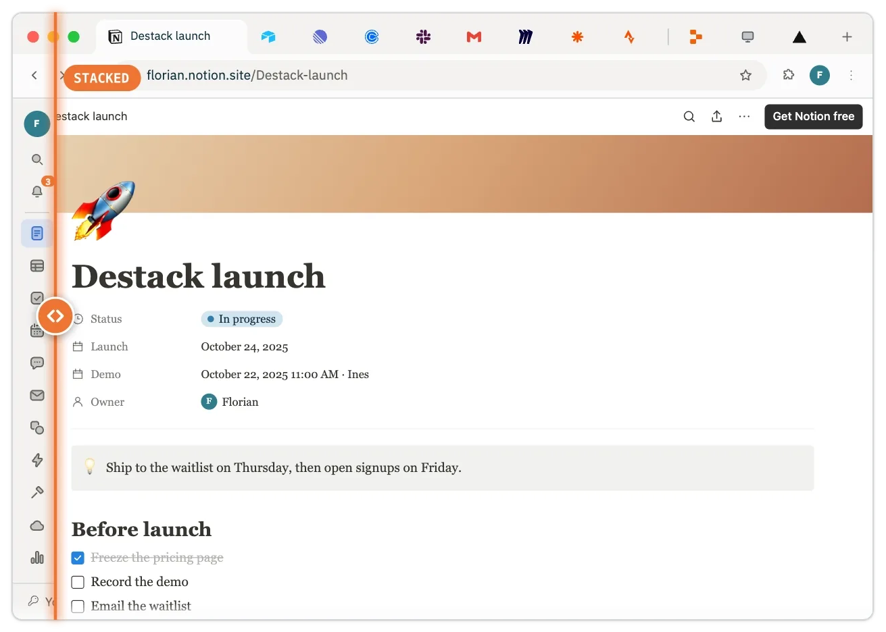

<div align="center">

## The Destack

<p>
    <a href="package.json"></a>
    <a href="LICENSE.txt"></a>
    <a href="https://github.com/destack-sh/destack/actions/workflows/release.yml"></a>
    <a title="Discord" target="_blank" href="https://discord.gg/xUFQ45TWYd"></a>
</p>

</div>

Destack is an open-source software engine for general purpose application software, just like Unity and Unreal are engines for games.
Think GitHub + NPM + Convex + Vercel + Sentry in one, with all the boring decisions already made: auth, schemas, migrations, multiplayer, permissions, workflows, telemetry and hosting.



To destack is to take back control over your software, step by step:
 1. Build high quality custom software, easily, in a standardised pipeline.
 2. Grow _your_ own suite of custom software, in one unified platform.
 3. Own your data and context, and take your software wherever you want.



---

The Destack comprises both the platform core for building malleable software _and_ standard apps for siloed SaaS applications (like Notion or Linear).
All apps built on Destack - ours and yours - get the advantages of standardisation and integration out of the box and are thus fully hackable and programmable by your agents.

_Your_ entire Destack - your own personal superapp, with your complete personal context, standardised apps, and custom tools - runs on a _single_ machine (e.g., a SQLite instance on a Cloudflare worker), on your laptop, or on your server.
Or you can let us host it for you.
Or any combination!



---

Moving in to Destack is a single prompt - just ask your agent:
```md
Set up my Destack: https://destack.me
```

Alternatively, you can install Destack manually:

```bash
curl -fsSL https://destack.sh/install | sh
```

Read more on [destack.sh](https://destack.sh): the [docs](https://destack.sh/docs/), the [hosted pricing](https://destack.sh/pricing/) and the [blog](https://destack.sh/blog/).

## Architecture

Destack is almost entirely written "in itself" using TypeScript and other modern boring Web technologies.
The actual "stack" is carefully composed with [incremental granularity](https://caseymuratori.com/blog_0016) in mind, roughly broken into the six layers of:

 1. **[Identity](ARCHITECTURE.md#01-identity)**: one account for every person, agent and app
 2. **[Presentation](ARCHITECTURE.md#02-presentation)**: one look and feel, on web, desktop and terminal
 3. **[Application](ARCHITECTURE.md#03-application)**: one API for access, workflows, messages and telemetry
 4. **[Persistence](ARCHITECTURE.md#04-persistence)**: one database, synced everywhere
 5. **[Source](ARCHITECTURE.md#05-source)**: every app's code, open to read and fork
 6. **[Infrastructure](ARCHITECTURE.md#06-infrastructure)**: runs anywhere, from your laptop to the edge

The packages of each layer, with what they do and the prior art they follow, are in [ARCHITECTURE.md](ARCHITECTURE.md).

## Contributing

Destack is not currently open for public source contributions, but we welcome feedback, issues, and ideas.

## License

Destack is fully open source under the MIT license across the full stack (see [LICENSE.txt](LICENSE.txt)).
