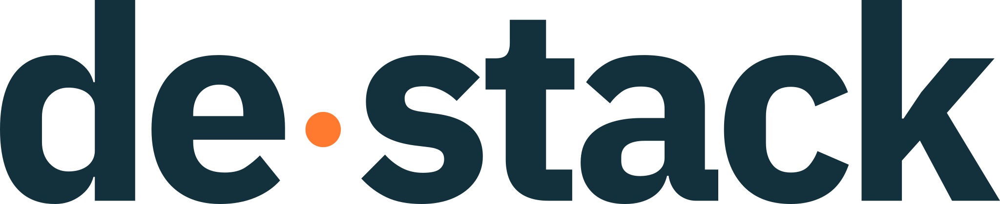

<p align="center">
  <a href="https://destack.sh">
    <picture>
      <source srcset="@platform/brand/wordmark/wordmark-dark.svg" media="(prefers-color-scheme: dark)">
      
    </picture>
  </a>
</p>
<p align="center">Own your whole stack, build great custom software, and bring all your agents.</p>
<p align="center">
  <a href="https://discord.gg/xUFQ45TWYd"></a>
  <a href="https://github.com/destack-sh/destack/actions/workflows/check.yml"></a>
  <a href="LICENSE.txt"></a>
</p>
<p align="center">
  <a href="https://destack.sh">Website</a> ·
  <a href="https://destack.sh/docs/">Docs</a> ·
  <a href="https://destack.sh/blog/">Blog</a>
</p>

---

Destack is an **open-source software engine** for building and deploying general purpose applications, much like what Unreal Engine is for games.
Think **GitHub + NPM + Convex + Vercel + Sentry in one**, with all the boring decisions already made: auth, migrations, services, multiplayer, workflows, telemetry, testing, and hosting.

Destack **standardises the tools and processes for software production**:
 1. **Build custom software** with your own AI, in a standardised pipeline.
 2. **Integrate every app and agent**: one account, one database, no walls.
 3. **Control your whole stack**: your data, context and code, on any machine you choose.

The Destack comprises both the platform core for building malleable software _and_ standard apps for common use cases (like Notion or Linear).
All apps built on Destack get the advantages of standardisation and integration out of the box and are thus fully hackable and programmable by your agents.

_Your_ entire Destack - your own personal superapp, with your complete personal context, standardised apps, and custom tools - runs on a _single_ machine (e.g., a SQLite instance on a Cloudflare worker), on your laptop, or on your server, or on our cloud.
It's as simple and portable as we could make it.

## Install

Moving in to your Destack is a single prompt - just ask your agent:
```md
Set up my Destack: https://destack.me
```

Alternatively, you can install Destack manually:

```bash
curl -fsSL https://destack.sh/install | sh
```

## Architecture

Destack is almost entirely written "in itself" using TypeScript and other modern boring Web technologies.
The actual "stack" is carefully composed with [incremental granularity](https://caseymuratori.com/blog_0016) in mind, generally organised into six layers:

 1. **[Identity](ARCHITECTURE.md#01-identity)**: one account for every person, agent and app
 2. **[Presentation](ARCHITECTURE.md#02-presentation)**: one look and feel, on web and desktop
 3. **[Application](ARCHITECTURE.md#03-application)**: one API for basically everything
 4. **[Persistence](ARCHITECTURE.md#04-persistence)**: one data plane, synced everywhere
 5. **[Source](ARCHITECTURE.md#05-source)**: every app's code, transparent, forkable
 6. **[Infrastructure](ARCHITECTURE.md#06-infrastructure)**: run anywhere, from your laptop to the edge

The packages of each layer, with what they do and the prior art they follow, are in [ARCHITECTURE.md](ARCHITECTURE.md).

## Contributing

Destack is not currently open for public *source* contributions, but we welcome feedback, issues, and ideas.

## License

Destack is fully open source under the MIT license across the full stack (see [LICENSE.txt](LICENSE.txt)).
